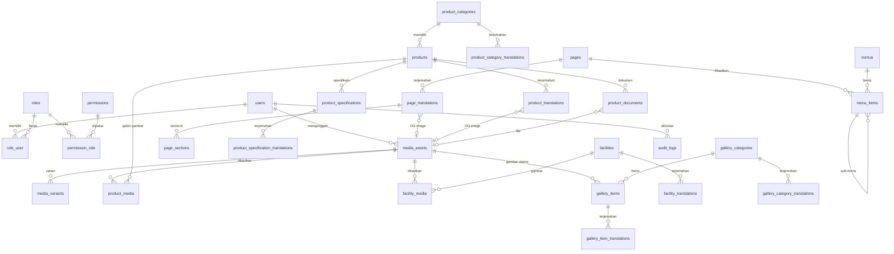

# ERD — Primainti (Phase 1)

Tanggal diperbarui: 13 Oktober 2026
Sumber kebenaran: migration di `database/migrations/` + verifikasi langsung `information_schema` MySQL 8.0.30 (database `primainti`).
Jumlah tabel: 33 (termasuk tabel infrastruktur bawaan Laravel).

## Diagram relasi

Tabel polymorphic `audit_logs.auditable_*` dapat menunjuk ke entitas konten apa pun (pages, products, facility, gallery_items, users) — tidak digambar agar diagram tetap terbaca.

Tabel infrastruktur bawaan tidak digambar: `sessions`, `cache`, `cache_locks`, `jobs`, `password_reset_tokens`, `migrations`.

## Daftar relasi + aturan delete (verifikasi live dari MySQL)

| # | Tabel anak | Kolom FK | Tabel induk | On delete | Nama constraint |
|---|---|---|---|---|---|
| 1 | audit_logs | user_id | users | SET NULL | audit_logs_user_id_foreign |
| 2 | facility_media | facility_id | facilities | CASCADE | facility_media_facility_id_foreign |
| 3 | facility_media | media_asset_id | media_assets | CASCADE | facility_media_media_asset_id_foreign |
| 4 | facility_translations | facility_id | facilities | CASCADE | facility_translations_facility_id_foreign |
| 5 | gallery_category_translations | gallery_category_id | gallery_categories | CASCADE | gallery_category_translations_gallery_category_id_foreign |
| 6 | gallery_item_translations | gallery_item_id | gallery_items | CASCADE | gallery_item_translations_gallery_item_id_foreign |
| 7 | gallery_items | gallery_category_id | gallery_categories | SET NULL | gallery_items_gallery_category_id_foreign |
| 8 | gallery_items | media_asset_id | media_assets | SET NULL | gallery_items_media_asset_id_foreign |
| 9 | media_assets | uploaded_by | users | SET NULL | media_assets_uploaded_by_foreign |
| 10 | media_variants | media_asset_id | media_assets | CASCADE | media_variants_media_asset_id_foreign |
| 11 | menu_items | menu_id | menus | CASCADE | menu_items_menu_id_foreign |
| 12 | menu_items | page_id | pages | SET NULL | menu_items_page_id_foreign |
| 13 | menu_items | parent_id | menu_items | SET NULL | menu_items_parent_id_foreign |
| 14 | page_translations | page_id | pages | CASCADE | page_translations_page_id_foreign |
| 15 | permission_role | permission_id | permissions | CASCADE | permission_role_permission_id_foreign |
| 16 | permission_role | role_id | roles | CASCADE | permission_role_role_id_foreign |
| 17 | product_category_translations | product_category_id | product_categories | CASCADE | product_category_translations_product_category_id_foreign |
| 18 | product_media | media_asset_id | media_assets | CASCADE | product_media_media_asset_id_foreign |
| 19 | product_media | product_id | products | CASCADE | product_media_product_id_foreign |
| 20 | product_specification_translations | product_specification_id | product_specifications | CASCADE | pst_spec_fk |
| 21 | product_specifications | product_id | products | CASCADE | product_specifications_product_id_foreign |
| 22 | product_translations | product_id | products | CASCADE | product_translations_product_id_foreign |
| 23 | products | product_category_id | product_categories | **RESTRICT** | products_product_category_id_foreign |
| 24 | role_user | role_id | roles | CASCADE | role_user_role_id_foreign |
| 25 | role_user | user_id | users | CASCADE | role_user_user_id_foreign |

Catatan penamaan: `pst_spec_fk` adalah nama eksplisit karena nama otomatisnya melebihi batas 64 karakter MySQL.

## Keputusan aturan delete (disengaja, sesuai PRD)

- **RESTRICT**: kategori produk tidak bisa dihapus selama masih ada produknya (data induk dijaga).
- **CASCADE**: baris terkait (terjemahan, pivot, varian) ikut hilang bersama induknya — struktur mengikuti induk.
- **SET NULL**: pengguna/kategori/media yang dihapus tidak menghapus konten — tautannya dinolkan, konten tetap ada.
- **Menghapus konten tidak pernah menghapus aset media**: tidak ada FK dari `media_assets` ke konten; hanya pivot/tautan yang ikut terhapus atau dinolkan.
- Soft delete dipakai pada: `media_assets`, `pages`, `product_categories`, `products`, `facilities`, `gallery_categories`, `gallery_items`.

## Unique constraint (penting)

| Tabel | Kolom | Kegunaan |
|---|---|---|
| page_translations | (locale, slug) + (page_id, locale) | Slug unik per locale; satu baris per halaman per locale |
| product_category_translations | (locale, slug) + (product_category_id, locale) | idem |
| product_translations | (locale, slug) + (product_id, locale) | idem |
| facility_translations | (locale, slug) + (facility_id, locale) | idem |
| gallery_category_translations | (locale, slug) + (gallery_category_id, locale) | idem |
| gallery_item_translations | (locale, slug) + (gallery_item_id, locale) | idem |
| product_specification_translations | (product_specification_id, locale) — `pst_locale_unique` | Satu label spesifikasi per locale |
| products | sku | Kode produk unik (nullable) |
| media_variants | (media_asset_id, variant) | Satu varian per aset |
| product_media | (product_id, media_asset_id) | Cegah duplikasi tautan |
| facility_media | (facility_id, media_asset_id) | idem |
| menus | location | Lokasi menu unik (mis. primary, footer) |
| site_settings | key | Kunci pengaturan unik |
| redirects | from_path | Path lama unik |
| roles / permissions | name | Nama unik |
| role_user | (role_id, user_id) — PK komposit | Cegah duplikasi relasi |
| permission_role | (permission_id, role_id) — PK komposit | idem |

## Aturan konten

- Kolom `status` (`draft`/`published`) ada di: `pages`, `product_categories`, `products`, `facilities`, `gallery_categories`, `gallery_items`. Query publik wajib memakai scope `published` (tersedia di model).
- `site_settings` hanya untuk pengaturan non-secret. Secret (API key, password SMTP) wajib di `.env` yang tidak ter-commit.

